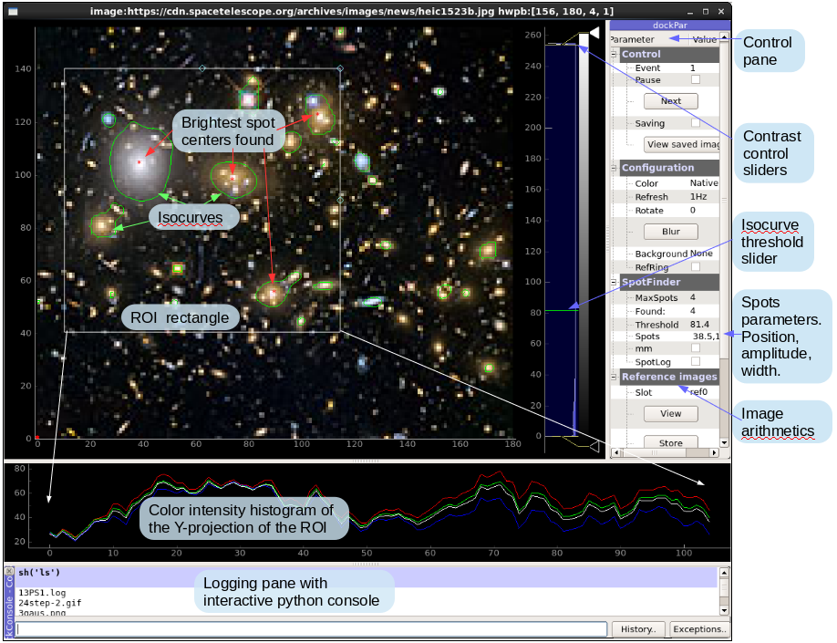

# Imagin

Imagin is a fast, interactive viewer and analyzer for streamed images and image files, built with Python, pyqtgraph, and SciPy.

## Installation

Install the core application with file-based image support:

```bash
pip install imagin
```

## Features

- **Input sources:**
  - EPICS PVAccess and Channel Access.
  - Image files, PNG is the default image format; other formats supported as well.
  - Video files, All modern codecs are supported through OpenCV, tested with FFV1, H265, H264, MPEG4.
  - HTTP image URLs.
  - USB cameras. Under development.
- Fast, robust characterization of multiple objects using fitted ellipsoids.
- Supports images with 16-bit or higher channel depth (for PNG and FFV1 codecs).
- Image orientation control and arbitrary rotation.
- Interactive zooming and panning.
- Contrast, intensity and color-map control.
- Region of interest (ROI) selection for image analysis.
- ROI partitioning.
- ROI projection plots.
- Optional Gaussian fitting in 1D or 2D for improved precision.
- De-speckling.
- Automatic background elimination using prominence filtering (de-basing).
- Background subtraction using reference images.
- Interactive calibration from pixels to millimeters.
- Reference image slots for saving and restoring images.
- Extensible through user-supplied add-ons.
- Fast browsing and cleanup of image directories.



[Publication](https://proceedings.jacow.org/icalepcs2019/papers/tucpr06.pdf)

## Examples

```bash
python -m imagin -b http https://cdn.esahubble.org/archives/images/large/heic1523b.jpg -t150
python -m imagin -b file sample_images/*.jpg -t195 -m40
python -m imagin -b file ~/Pictures/*.png
python -m imagin -b file ~/Videos/beam-emittance_moving-slit.mkv -t100 -m1 -e3
```

### Testing with the EPICS PVAccess image simulator (`epicsdev.imagegen`)

```bash
pip install epicsdev
python -m epicsdev.imagegen -c &
python -m imagin -t 100 image0:image -b pva -m 9
```

Animate by changing image parameters from a Python script:

```python
import time
import numpy as np
from p4p.client.thread import Context

iface = Context("pva")

one_to_zero = 1 - np.linspace(0, 1, 11)
scales = np.append(one_to_zero[:-1], np.flip(one_to_zero)[2:])

for scale in scales:
    iface.put("image0:gridScaleX", scale)
    time.sleep(0.1)
```
